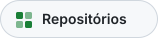

<picture>
  <source media="(prefers-color-scheme: dark)" srcset="./assets/header-dark.svg">
  
</picture>

  <a href="https://www.linkedin.com/in/gabriel-correia-reis"><picture><source media="(prefers-color-scheme: dark)" srcset="./assets/btn-linkedin-dark.svg"></picture></a>&nbsp;
  <a href="mailto:correiareisg@gmail.com"><picture><source media="(prefers-color-scheme: dark)" srcset="./assets/btn-email-dark.svg"></picture></a>&nbsp;
  <a href="https://github.com/gabcorreiadev?tab=repositories"><picture><source media="(prefers-color-scheme: dark)" srcset="./assets/btn-github-dark.svg"></picture></a>

 

### Olá! Eu sou o Gabriel.

Comecei na tecnologia aos **18 anos**, no curso de **Web Front-End do SENAI Barueri**. Foi ali que escrevi minhas primeiras linhas de HTML e CSS e percebi que queria construir coisas que as pessoas usam de verdade.

De lá pra cá, passei por **UX na Paynet**, por **front-end com Angular na Revizia** e hoje, aos 21, sou **Desenvolvedor Front-End Jr na Be.Aliant**, criando e mantendo soluções web para clientes. Em dezembro de 2026 concluo o **Tecnólogo em Sistemas para Internet** pela Estácio.

Gosto de interfaces bem acabadas, código organizado e daquele detalhe de UI que ninguém pede, mas todo mundo percebe.

 

<picture>
  <source media="(prefers-color-scheme: dark)" srcset="./assets/timeline-dark.svg">
  
</picture>

 

<picture>
  <source media="(prefers-color-scheme: dark)" srcset="./assets/stack-dark.svg">
  
</picture>

 

### Projetos em destaque

<table>
  <tr>
    <td width="50%" valign="top">
      <h4><a href="https://github.com/gabcorreiadev/boxdiario">Box na Veia</a></h4>
      TypeScript · API · Netlify
      
Site de Fórmula 1 com a próxima corrida, onde assistir, história da categoria e cards dos grandes pilotos.

      <a href="https://boxnaveia.netlify.app">ver online →</a>
    </td>
    <td width="50%" valign="top">
      <h4><a href="https://github.com/gabcorreiadev/tracker">Tracker de Estreias</a></h4>
      TypeScript · consumo de API · infinite scroll
      
Catálogo de estreias de cinema com filtros dinâmicos, paginação, skeletons e elenco de cada filme.

    </td>
  </tr>
  <tr>
    <td width="50%" valign="top">
      <h4><a href="https://github.com/gabcorreiadev/newburger">New Burger</a></h4>
      SCSS · Figma → código
      
Implementação fiel de um protótipo do Figma para uma hamburgueria, com foco em layout responsivo.

    </td>
    <td width="50%" valign="top">
      <h4><a href="https://github.com/gabcorreiadev/aniljeans">Aniljeans</a></h4>
      TypeScript
      
Catálogo online para uma loja de moda jeans.

    </td>
  </tr>
</table>

 

<picture>
  <source media="(prefers-color-scheme: dark)" srcset="./assets/stats-dark.svg">
  
</picture>

  

Fora do código: baterista nas horas vagas, faixa branca no jiu-jítsu e palmeirense.

<picture>
  <source media="(prefers-color-scheme: dark)" srcset="./assets/footer-dark.svg">
  
</picture>
